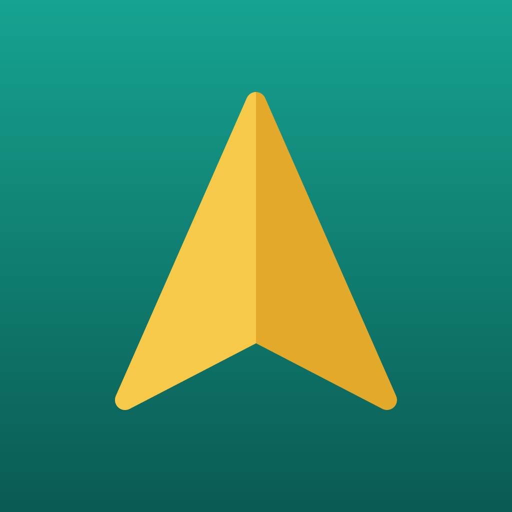

<p align="center">
	
</p>

<h1 align="center">NavOSS</h1>

<p align="center">
	Account-free, privacy-first navigation for iPhone and CarPlay, built in the open, starting in Calgary.
</p>

<p align="center">
	<a href="https://navoss.yassin.app">Project site</a> · <a href="https://github.com/yassinsolim/NavOSS/issues">Issues</a> · <a href="https://github.com/yassinsolim/NavOSS/discussions">Discussions</a>
</p>

<p align="center">
	<a href="https://github.com/yassinsolim/NavOSS/actions/workflows/ci.yml"></a>
	
	
	
</p>

NavOSS is an independently designed navigation app built on OpenStreetMap-derived data, MapLibre and Valhalla. There is no account or advertising. The default build has no analytics SDK; build 80 includes Google's Places SDK, whose privacy declarations are described in the policy. Search, routing, spoken guidance, rerouting and fixed safety-camera alerts run against a self-hosted service in Alberta; route matching, guidance and speech run on the phone. The current milestone is an iPhone and CarPlay technical beta distributed through TestFlight. Android and broader coverage come after the iOS navigation and operations gates are earned.

> [!WARNING]
> NavOSS is pre-release software. The service it talks to today has no live traffic and no production guarantee. Do not rely on it as your only source for navigation, closures, road rules or safety-camera information. Have a passenger operate the controls while a vehicle is moving.

## Status

This status distinguishes the deployed service from individual builds. Build availability must be confirmed in App Store Connect.

### TestFlight builds

The deployed `/v2/routes` service provides Alberta and British Columbia routing with lane and signpost data when returned.

Build `0.1.0 (80)` from `141b394` (native contract v11, `production-carplay-google`) is available to internal testers. It carries the App Attest entitlement and Google place panel. On the enabled production service, drivers can opt in to share road reports or traffic speeds; reports from verified installations appear unconfirmed until corroborated, while traffic is collected for evaluation and not displayed. Builds before 80 cannot share. No real iPhone had registered through App Attest before the enablement decision. Interactive CarPlay remains unverified on a head unit.

Build `0.1.0 (75)` from `d0594cd` (native contract v10) supports v2 routing, including lane guidance and signposts when returned, but cannot share reports or traffic.

Build `0.1.0 (70)` from `afa4067` (native contract v8, the phone UI before the refresh) uses the compatible v1 endpoints for Calgary and Kelowna:

| Area                 | What the build does                                                                                                                                               |
| -------------------- | ----------------------------------------------------------------------------------------------------------------------------------------------------------------- |
| Map and search       | MapLibre map, place and address search, tappable places with OpenStreetMap details, Explore categories, saved and recent destinations (stored only on the device) |
| Routing and guidance | Route choices, avoid highways, native spoken turn-by-turn that continues with the phone locked, rerouting, arrival, ETA sharing through the system share sheet    |
| CarPlay              | Native CarPlay scene with search, route preview, Start/End, Dashboard, maneuvers, estimates and reconnect recovery                                                |
| Safety cameras       | Official City of Calgary intersection safety cameras with direction-aware alerts                                                                                  |
| Road reports         | The report button stores up to 25 two-hour private drafts on the device. Nothing is sent or shown to other drivers                                                |
| Not in this build    | Live traffic, lane guidance, signposts, shared road reports, offline maps, the refreshed phone UI, instrument-cluster and Siri route-preview support              |

### Build 75 and merged code

The features below are in uploaded build 75 unless otherwise noted; offline maps remain unavailable.

| Area                           | State on `main`                                                                                                                                                                                                                                                         |
| ------------------------------ | ----------------------------------------------------------------------------------------------------------------------------------------------------------------------------------------------------------------------------------------------------------------------- |
| Phone UI refresh (#78)         | Design system (`src/theme`, `src/ui`), gesture bottom sheets, a decomposed map screen with controller hooks, light and dark, loading/empty/error/offline/location-denied states                                                                                         |
| Native contract v10 (#75, #84) | Indexed route matching, geometry-derived guidance, reroute consent modes, native camera alerts and speeding state, and `/v2/routes` step metadata. The client falls back to `/v1/routes` against a server that lacks `/v2/routes`                                       |
| CarPlay quality pass (#77)     | Course-up camera, drawn maneuver symbols, "then" guidance, optional lane guidance, faster search and voice recovery, reroute and camera alerts, instrument-cluster scene, Siri route preview. Not exercised on a head unit                                              |
| Lanes and signposts (#84)      | Phone and CarPlay can show lanes and exit signs when the deployed v2 server returns them; build 75 uses v2. Interactive CarPlay is unverified on a head unit                                                                                                            |
| Offline maps app side (#83)    | On-device offline maps, routing (Valhalla 3.9.1 via Rallista valhalla-mobile) and search are in build 75, but no bundles are hosted and the manifest returns 503, so offline maps are not available. Privacy manifest declares Disk Space                               |
| Community client (#85)         | Native Swift client for community road reports and traffic, shared by phone and CarPlay, with App Attest and a JS bridge. Sharing is off by default. Build 80 carries the entitlement needed to share; build 75 cannot share.                                           |

### Deployed service

The production service (`https://navoss-api.yassin.app`) was deployed on 2026-11-15 from `f780903`. The v2 API covers Alberta and British Columbia and returns lane and signpost data when available; v1 remains compatible with build 70. Clients still degrade quietly when a server lacks a capability.

| Area                                        | State                                                                                                          |
| ------------------------------------------- | -------------------------------------------------------------------------------------------------------------- |
| Alberta and British Columbia coverage (#79) | Deployed; the 22-directed-route regional matrix passed 22/22                                                   |
| `/v2/routes` lanes, signposts (#79, #86)    | Deployed; the app's JS client planned Calgary to Banff with lane and signpost steps                            |
| Community road reports (#73)                | `attested`: build 80 onward may share; verified reports are unconfirmed until corroborated                     |
| Community traffic (#76, #82, #86)           | `collect`: opted-in speeds counted in memory for evaluation; nothing shown or used in routes                   |
| Offline bundles (#80)                       | Not available: no bundles are hosted and the manifest returns 503                                              |

Remaining enablement steps are in [the next-build checklist](docs/release/next-build-checklist.md).

## Architecture

```text
apps/mobile                        Expo + React Native iOS client
	src/theme, src/ui                Design tokens and primitives (colour roles, type, space, sheets)
	src/features/map                 One map screen; behaviour in controller/* hooks
	src/features/navigation          Guidance presentation; JS bridge to the native core
	modules/navoss-navigation        Native Swift core: matching, guidance, rerouting, speech,
	                                 routes client, community and traffic client (App Attest)
	carplay/ios                      CarPlay main, Dashboard and cluster scenes, App Intent
apps/api                           Fastify API: search, routing (v1 and v2), config, cameras,
                                   community reports, community traffic, offline manifest
apps/site                          Static website (CSP script-src 'none', no third-party requests)
packages/contracts                 Shared strict Zod contracts (coverage, routes, reports, traffic, offline)
infra                              Compose stack, Valhalla/Nominatim ops, offline bundle pipeline
docs                               Architecture, data provenance, privacy, tests, release evidence
.agents/skills/product-design      Product-design skill for agents (surfaces, copy rules, states)
```

- **Design system.** The phone UI uses role-based colour tokens for light and dark, a type scale, spacing, radii and motion in `apps/mobile/src/theme`, and shared primitives in `src/ui` (`Button`, `Banner`, `StateView`, `BottomSheet`, ...). Sheets are driven by one Reanimated value on the UI thread. Contrast is tested.
- **Controller hooks.** `map-screen.tsx` is a composition root; behaviour lives in `features/map/controller/*`. Camera frames never re-render the screen.
- **Native contract v10.** The Swift module owns location, matching, guidance, rerouting with consent modes, speech, camera eligibility and phone/CarPlay state. The phone and CarPlay are consumers. The routes client discovers `/v2/routes` through `/v2/config` and falls back to `/v1/routes`.
- **Community and traffic services.** Reports are structured, expiring and account-free, authenticated with Apple App Attest (`/v2/community/*`); verified reports are shown unconfirmed until corroborated. Opt-in traffic batches (`/v2/traffic/*`) are collected and counted in memory for evaluation, not published or used in routes. Both switches are off by default in the app; builds before 80 cannot share. Design: [community reports](docs/architecture/community-reports.md), [community traffic](docs/architecture/community-traffic.md).
- **Offline pipeline.** `infra/offline` builds checksummed regional PMTiles, Valhalla 3.9.1 graphs and SQLite search, described by a manifest. The app side (#83) is in build 75 onward, but has no bundles to download yet.
- **Coverage follows the server.** The app names the coverage the server declares and never invents it.

The mobile client does not depend on provider-specific route models. Public Photon and FOSSGIS services are development dependencies only; release builds require a stable HTTPS API.

## Run it locally

Toolchain: Node.js 24.18.0 and pnpm 11.13.1 through Corepack (`mise.toml` pins both). The maintainer's Mac currently has Xcode 27.2; CI and release runners use Xcode 26.6. MapLibre needs the custom NavOSS development client; Expo Go cannot run this app.

```sh
corepack pnpm install --frozen-lockfile
```

Start the API on the mobile-development port (3000 may be taken):

```sh
HOST=0.0.0.0 PORT=3001 corepack pnpm --filter @navoss/api dev
```

Without a configuration the API uses the public FOSSGIS Valhalla and Photon development services and labels the result as degraded; point `VALHALLA_URL` and `PHOTON_URL` at self-hosted services to avoid that. Community reports and traffic need PostGIS, migrations (`node dist/migrate.js`), App Attest settings and, for the Simulator, `COMMUNITY_ATTESTATION_MODE=allow-development`; see [infra/compose/README.md](infra/compose/README.md).

Build and open the iOS development client, then use Metro for JavaScript-only changes:

```sh
corepack pnpm --filter @navoss/mobile ios
corepack pnpm --filter @navoss/mobile start:simulator
```

Notes that cost time:

- Xcode 27.2 has no CarPlay Simulator window, and Device Hub disables it for simulators. Interactive CarPlay cannot be run here. `corepack pnpm validate:navigation:ios --carplay-only` renders the production CarPlay map with a labelled mock of the template chrome.
- If the dev client cannot reach Metro, start Metro with `REACT_NATIVE_PACKAGER_HOSTNAME=127.0.0.1` and without `--localhost` (otherwise it can bind only to `::1`), and launch the app on its own instead of through the dev-client deep link.
- An active trip is restored on relaunch: end navigation first. Set the simulator location immediately before requesting a route.
- `apps/mobile/ios` is generated and ignored; change config, plugins, `carplay` or `modules`, then regenerate.

Device testing with a personal team, EAS profiles and the TestFlight pipeline are documented in [docs/development/macos-handoff.md](docs/development/macos-handoff.md), [docs/release/ci-cd.md](docs/release/ci-cd.md) and [docs/release/testflight.md](docs/release/testflight.md).

Useful API endpoints on a local server: `GET /health`, `GET /ready`, `GET /v1/config`, `GET /v2/config`, `POST /v1/search`, `POST /v1/routes`, `POST /v2/routes`, `GET /v1/cameras`, `GET /openapi.json`. Search and route requests are sent as JSON bodies, processed in memory and discarded; routine access logging is disabled.

## Quality gates

```sh
corepack pnpm check
corepack pnpm lint
corepack pnpm test
corepack pnpm build
corepack pnpm format:check
```

CI runs those five, plus a check that `THIRD_PARTY_NOTICES.md` is current, native Swift tests, CarPlay generated-source parity and scene declarations, and the **PostGIS suites** (community reports and traffic) against a `postgis/postgis:16-3.5-alpine` service with `NAVOSS_REQUIRE_TEST_DATABASE=1`, so they fail instead of silently skipping. Locally those suites skip when no database variable is set.

For native navigation changes also run `corepack pnpm --filter @navoss/mobile test:native:ios` and a full Xcode compile. Maestro journeys and the iOS validation harness are listed in [apps/mobile/README.md](apps/mobile/README.md) and [docs/testing/navigation-validation.md](docs/testing/navigation-validation.md).

## Limitations

- **Coverage.** The deployed v2 service covers Alberta and British Columbia; build 70 uses v1 for Calgary and Kelowna.
- **No live traffic or traffic-aware ETA.** Lane guidance and signposts appear only when returned by v2 and are unavailable in build 70.
- **No offline maps for users.** The app side is in build 75, but no bundle hosting exists. The app needs a connection to the NavOSS service for search and routing.
- **CarPlay is not validated on a head unit.** Apple's CarPlay Navigation entitlement is approved; real wired and wireless checks are still outstanding.
- **iOS only.** Android is planned after the iOS navigation core is stable.
- **Map matching** is geometric; it does not use road-network topology. Background guidance and spoken instructions still need sustained on-road evidence.
- **Data is incomplete.** OpenStreetMap, City of Calgary and DriveBC data can be missing, wrong or late; camera alerts are informational and do not replace signs and signals.
- **Single operator.** There is no staffed support, no service-level agreement and no direct support email yet.
- **External TestFlight is manual** and has not been opened for the new code.

## Contributing

Issues and focused pull requests are welcome while the technical-beta boundaries remain explicit.

- Read [CONTRIBUTING.md](CONTRIBUTING.md) for setup, tests, DCO sign-off, safety and data rules, and [AGENTS.md](AGENTS.md) for agent and maintainer conventions.
- Use the structured [issue forms](https://github.com/yassinsolim/NavOSS/issues/new/choose) for bugs, route-quality reports and proposals.
- Report vulnerabilities privately according to [SECURITY.md](SECURITY.md).
- Follow the [Code of Conduct](CODE_OF_CONDUCT.md) and [governance model](GOVERNANCE.md).

Never submit private addresses, personal trip traces, credentials, or map data copied from proprietary navigation products.

## More documentation

- [Privacy policy](docs/privacy.md), [data sources](docs/data-sources.md), [support page](docs/support.md)
- [TestFlight runbook](docs/release/testflight.md), [next-build checklist](docs/release/next-build-checklist.md), [App Store metadata](docs/release/app-store-metadata.md), [App Review readiness](docs/release/app-review.md)
- [CarPlay architecture](docs/architecture/carplay.md) and [feature parity](docs/testing/carplay-feature-parity.md)
- [Route-quality evidence](docs/testing/route-quality.md)

## Licensing and attribution

NavOSS uses a directory-based license split:

- `apps/mobile` and `packages/contracts`: MPL-2.0;
- `apps/api` and future hosted backend/operations/data-pipeline code: AGPL-3.0-only; and
- documentation and brand assets: all rights reserved unless stated otherwise.

See [LICENSE](LICENSE), [LICENSES/README.md](LICENSES/README.md) and [THIRD_PARTY_NOTICES.md](THIRD_PARTY_NOTICES.md). OpenStreetMap, City of Calgary, DriveBC and other data keep their own licenses and attribution requirements; details are in [docs/data-sources.md](docs/data-sources.md).
